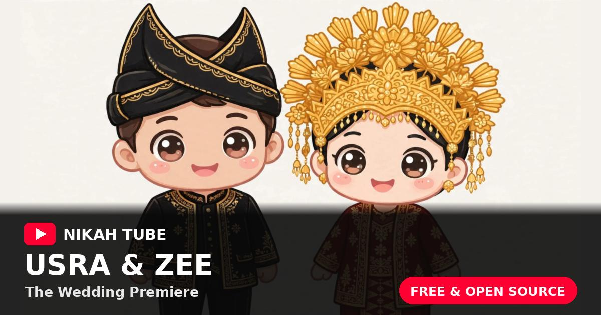

# YuuNikah — A YouTube-Style Digital Wedding Invitation

A digital wedding invitation dressed as a video watch page: a premiere thumbnail, a working Subscribe button, a comments section as the guestbook, and an Up Next gallery. Free and open source.

**Live demo:** https://yuunikah.xsrazy.web.id

**Dashboard:** https://yuunikah.xsrazy.web.id/dashboard

> YuuNikah is inspired by the interface of online video platforms. It is not affiliated with or endorsed by YouTube.

## About

YuuNikah wraps a complete wedding invitation (premiere countdown, event details, gallery, RSVP, guestbook, love gift, background music) in the most familiar interface on the internet: a video page. The wedding is a "premiere": there is a 16:9 thumbnail with a play button, a live countdown to the big day, a "Set Reminder" button for saving the date, a couple's channel with a Subscribe button that is actually recorded by the backend, and a comments section that doubles as the guestbook.

Everything on the page is managed from the admin dashboard: the couple's names, the thumbnail, the music, the schedule, the venue, the gallery, even the love gift account numbers. No code changes are needed to make the invitation yours.

## Features

- **Premiere gate**: the invitation opens from a 16:9 video thumbnail with a big play button, a PREMIERE badge, and a live countdown.
- **Channel header**: a banner strip and channel row (avatar, verified channel name, live subscriber count, Subscribe button) with a tab bar (Beranda / Video / Playlist / Komunitas) that smooth-scrolls to each section; the Playlist tab also expands the description.
- **Video stage**: a player-style stage (play/pause, red progress bar, timestamps, like button) that actually plays the background music, in a two-column watch layout with the Up Next sidebar on desktop.
- **Countdown and Set Reminder**: a live countdown to the wedding day; "Set Reminder" opens Google Calendar (Save the Date), next to a Google Maps button for the venue.
- **Real Subscribe**: the channel Subscribe button follows both partners at once and is recorded per visitor in the backend (subscribe/unsubscribe toggle); the subscriber count is the couple's combined fan count and updates live. Each partner also has an individual Follow button in the About section.
- **Comments as guestbook**: post wishes with an RSVP status (Datang, Berhalangan, or Masih Ragu), like, reply (nested), edit, and delete your own comments (two-step inline confirm, no dialog). Filter chips switch between all comments and newest first. A built-in bad-word filter is included. The admin can pin one comment from the dashboard; it stays first with a "Disematkan" badge.
- **Up Next gallery**: the sidebar lists gallery photos as video thumbnails, complete with fake durations.
- **Shorts row**: the same gallery photos appear again as vertical 9:16 Shorts cards in a horizontal row; clicking one opens the full photo.
- **Collapsible description box**: starts collapsed behind a "...selengkapnya" toggle and holds event chapters (ceremony and reception), venue and address, dress code, a holy verse, "channel" statistics, and love gift accounts (SeaBank and DANA) with working copy buttons.
- **Admin dashboard**: YouTube Studio-style dashboard (header plus sidebar navigation, analytics overview, video-details content editor, comment moderation queue, guest list). Secure login (scrypt-hashed password, JWT with revocation), media uploads (images are downscaled and re-encoded to WebP in the browser, audio up to 3 MB), guest list management, statistics, CSV export, and access-key rotation.
- **SEO ready**: Open Graph and Twitter Card metadata, canonical URL, sitemap, and JSON-LD. Every `*.vercel.app` host permanently redirects to the main domain, and unknown paths bounce back to the homepage.

## Architecture

- **Frontend**: vanilla HTML, CSS, and JavaScript. No framework, no build step, no CDN. The public page is a single `index.html` with `css/app.css` and `js/app.js`; the dashboard is a custom YouTube Studio-style interface (`dashboard.html` with `css/dashboard.css` and vanilla JS in `js/`).
- **Backend**: zero-dependency Node.js Vercel Functions in `api/`. All data (settings, site content, comments, guests, follows) lives in a single versioned JSON document in a private Vercel Blob store, written with optimistic concurrency.
- **Authentication**: admins use JWTs (HS256) issued by the session endpoint; guests use an access key sent as the `x-access-key` header, published by the public config endpoint.
- **Hosting**: Vercel (static hosting, serverless functions, Blob storage) with the custom domain `yuunikah.xsrazy.web.id`.

### API

| Endpoint | Method | Description |
| --- | --- | --- |
| `/api/config` | GET | Public: site content, guest access key, follow counts, visitor follow state |
| `/api/session` | POST, DELETE | Admin login (issues JWT) and logout/revoke |
| `/api/user` | GET, PATCH | Admin profile and settings, including site content (whitelisted fields) |
| `/api/key` | PUT | Rotate the guest access key |
| `/api/stats` | GET | Dashboard statistics (admin) |
| `/api/download` | GET | Export guests and comments to CSV (admin) |
| `/api/comment` | GET, POST | List comments (public, access key required) and post a comment or reply |
| `/api/comment/:id` | POST, PATCH, PUT, DELETE | Like, unlike, edit, delete a comment |
| `/api/guest` | GET, POST | List and add guests |
| `/api/guest/:id` | PUT, DELETE | Update and delete a guest |
| `/api/follow` | POST | Toggle a visitor's subscribe/follow for a partner |
| `/api/upload` | POST | Upload media (admin, base64 JSON) into the Blob store |
| `/api/media/:name` | GET | Public streaming proxy for uploaded media (Range requests supported) |

### Environment Variables

Names only. Values belong in the Vercel project settings, never in this repository:

- `AUTH_SECRET`
- `ADMIN_EMAIL`
- `ADMIN_PASSWORD`
- `INITIAL_ACCESS_KEY`
- `BLOB_READ_WRITE_TOKEN`

## Notes

- The bundled demo content features "Usra & Zee", Monday, January 17, 2050 at Jam Gadang, Bukittinggi. Replace everything from the dashboard.
- The bundled love gift numbers are dummy numbers for demo purposes.
- The bundled background music is a short piano loop as a placeholder.

## Credits

Created by Rahmatul Usra. YuuNikah is part of a family of platform-parody wedding invitation templates: [Nikah](https://github.com/xsrazy/Nikah), [NikahFix](https://github.com/xsrazy/NikahFix), and [Wedify](https://github.com/xsrazy/Wedify).

## License

MIT. See the `LICENSE` file.
